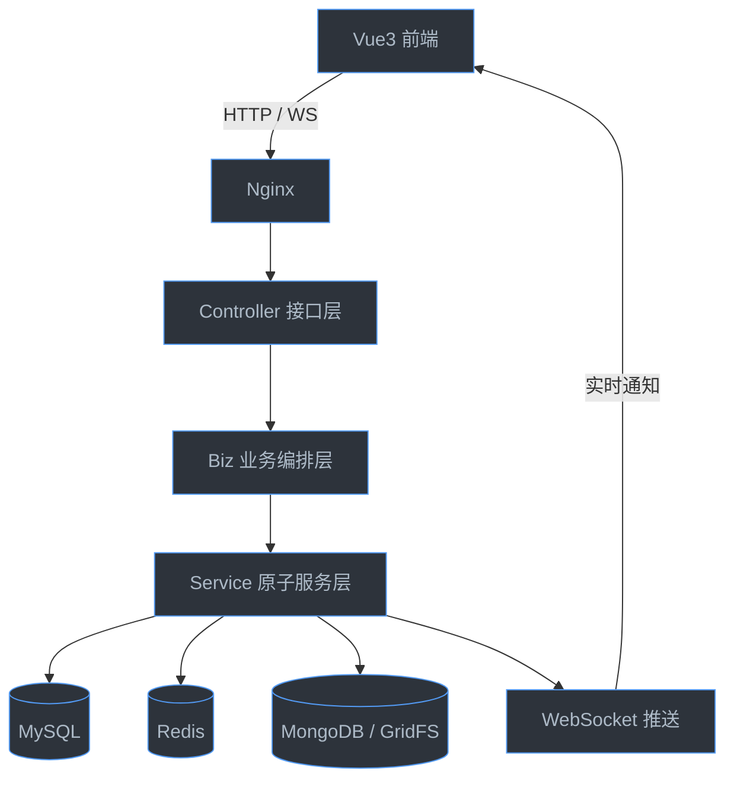

# 校园宿舍报修与维修工单派单系统

> 将「报修 — 派单 — 上门 — 完工 — 评价 — 统计」全流程线上化、可追溯的校园宿舍维修管理系统。

系统面向 **学生 / 维修人员 / 宿舍管理员** 三类角色，支持管理员按楼栋派单与维修工主动抢单两种模式，覆盖工单全生命周期、超时考核、服务评价与数据可视化，并提供基于 Spring AI + DeepSeek 的智能助手。

---

## 目录

- [功能特性](#功能特性)
- [技术栈](#技术栈)
- [系统架构](#系统架构)
- [目录结构](#目录结构)
- [快速开始](#快速开始)
- [环境变量](#环境变量)
- [默认账号](#默认账号)
- [接口文档](#接口文档)
- [生产部署](#生产部署)
- [项目文档](#项目文档)

---

## 功能特性

### 学生端

- 提交报修单：楼栋 → 房间 → 故障类型 → 现场照片（1~6 张）→ 问题描述，自动生成工单号
- 查看处理进度：工单列表 + 详情时间轴（状态流转轨迹）
- 确认完工并评价：1~5 星 + 评价标签 + 文字评价，支持匿名
- 服务公告：查看维修工平均星级评分榜与匿名评价明细，支持按维修工、星级筛选

### 维修端

- 抢单池抢单（Redis 分布式锁防并发超卖）
- 接单 / 拒单 / 释放工单
- 到场登记，自动计算响应时长
- 填写维修过程、更换配件明细
- 提交完工并上传维修后照片
- 个人工单列表与绩效统计

### 管理端

- 按楼栋区域派单、调整优先级（P1~P4，留痕）
- 工单看板（按状态分列）、超时列表与手动标记超时
- 统计报表：故障类型分布、平均处理时长、返修率、维修工绩效排行
- 用户管理、基础数据（楼栋 / 房间 / 故障类型）维护
- 首页轮播图管理与服务公告管理
- 全站通知查看（按已读状态、通知类型、接收人多维筛选）

### 通用能力

- JWT 无状态鉴权 + 角色权限 + 接口级越权校验
- WebSocket 实时通知（心跳保活、断线重连、单用户最多 3 连接）
- 工单自动超时扫描、自动确认、自动关闭定时任务
- 图片存储于 MongoDB GridFS，支持按工单 / 类型限制数量与格式
- AI 智能助手：基于知识库 + 角色权限的回答，流式输出（SSE）、会话与限流

---

## 技术栈

### 后端

| 分类 | 技术 |
| --- | --- |
| 语言 / 运行时 | Java 17 |
| 框架 | Spring Boot 3.5.16、Spring Security、Spring AOP、Spring Validation |
| 持久层 | MyBatis-Plus 3.5.17（QueryWrapper + 分页插件）、MySQL 8 |
| 中间件 | Redis（缓存 / 分布式锁 / 限流 / 会话）、MongoDB（轨迹日志、GridFS 图片）、RabbitMQ（可选，默认关闭） |
| 鉴权 | JJWT 0.12.3 |
| 实时通信 | Spring WebSocket |
| 对象映射 | MapStruct 1.5.5、Lombok |
| 接口文档 | springdoc-openapi 2.8.9（Swagger UI） |
| AI | Spring AI 1.1.8 + DeepSeek（`deepseek-chat`） |
| 构建 | Maven |

### 前端

| 分类 | 技术 |
| --- | --- |
| 框架 | Vue 3.5（Composition API） |
| 构建 | Vite 5.4 |
| UI | Element Plus 2.8（按需引入） |
| 状态管理 | Pinia 2 |
| 路由 | Vue Router 4 |
| 请求 | Axios |
| 图表 | ECharts 5 |
| 包管理 | Yarn 1.22 |

---

## 系统架构



后端严格分层：`Controller → Biz → Service → Mapper`，Controller 只做参数校验与响应封装，Biz 负责业务编排与事务，Service 提供可复用的原子能力。

核心数据表（共 15 张）：`t_user`、`t_building`、`t_room`、`t_fault_type`、`t_work_order`、`t_order_image`、`t_repair_round`、`t_order_acceptance`、`t_dispatch_record`、`t_repair_record`、`t_part_usage`、`t_evaluation`、`t_timeout_record`、`t_notice`、`t_manager_building`。

---

## 目录结构

```text
school_repairs/
├── backend/                     # Spring Boot 后端
│   ├── pom.xml
│   └── src/main/
│       ├── java/com/cqust/repair/
│       │   ├── common/          # 统一响应、异常、枚举、基础实体
│       │   ├── config/          # Redis / Mongo / WebSocket / 安全等配置
│       │   ├── infra/           # 基础设施封装
│       │   ├── module/          # 业务模块
│       │   │   ├── auth/        # 登录、刷新令牌
│       │   │   ├── user/        # 用户与角色
│       │   │   ├── basedata/    # 楼栋、房间、故障类型
│       │   │   ├── order/       # 工单、派单、维修、验收、状态机、定时任务
│       │   │   ├── rating/      # 服务评价
│       │   │   ├── stat/        # 统计报表
│       │   │   ├── notice/      # 站内通知
│       │   │   ├── carousel/    # 首页轮播
│       │   │   ├── file/        # 文件上传（GridFS）
│       │   │   └── ai/          # AI 智能助手
│       │   └── websocket/       # 通知推送、会话管理、JWT 握手拦截
│       └── resources/
│           ├── application.yml          # 主配置
│           ├── application-dev.yml      # 开发环境（本地 MySQL/Redis/Mongo）
│           ├── application-prod.yml     # 生产环境
│           ├── ai/knowledge/            # AI 知识库（角色与规则说明）
│           └── mapper/                  # MyBatis-Plus XML
├── frontend/                    # Vue 3 前端
│   ├── package.json
│   ├── vite.config.js           # 端口 5173，代理 /api 与 /ws 到 8080
│   └── src/
│       ├── api/                 # 接口封装
│       ├── components/          # 公共 / 业务 / 图表组件
│       ├── composables/         # 组合式函数
│       ├── layout/              # 布局
│       ├── router/              # 路由与守卫
│       ├── stores/              # Pinia
│       ├── views/               # 页面（student / repairer / admin）
│       └── utils/               # 工具（请求、WebSocket 客户端等）
├── deploy/
│   ├── nginx/                   # Nginx 反向代理配置
│   └── sql/                     # 建表、初始化数据、增量迁移脚本
└── docs/                        # 后端 / 前端 / 测试 / AI 方案文档
```

---

## 快速开始

### 1. 环境要求

| 依赖 | 版本 | 是否必需 |
| --- | --- | --- |
| JDK | 17+ | 必需 |
| Maven | 3.9+ | 必需 |
| Node.js | 18+ | 必需 |
| Yarn | 1.22+ | 必需 |
| MySQL | 8.0+ | 必需 |
| Redis | 6.0+ | 必需 |
| MongoDB | 5.0+ | 必需（图片依赖 GridFS） |
| RabbitMQ | 3.x | 可选，默认关闭（`repair.mq.enabled=false`） |

### 2. 初始化数据库

```bash
mysql -u root -p < deploy/sql/schema.sql
mysql -u root -p < deploy/sql/init_data.sql
```

- `schema.sql`：创建数据库 `school_repair` 与全部表结构
- `init_data.sql`：初始化楼栋、房间、故障类型与默认账号
- `migration_b_plus_repair_round.sql`：返修轮次相关增量迁移脚本，仅在升级旧库时执行

### 3. 启动后端

```bash
cd backend
mvn spring-boot:run
```

Windows PowerShell 下如需自定义连接信息：

```powershell
$env:DB_USER="root"
$env:DB_PASSWORD="your-password"
$env:DEEPSEEK_API_KEY="your-deepseek-key"   # 关闭 AI 时可改为 $env:AI_ENABLED="false"
mvn spring-boot:run
```

> 默认启用 AI 助手且缺少 `DEEPSEEK_API_KEY` 时，后端会启动失败。不需要 AI 时请设置 `AI_ENABLED=false`。

默认监听 `http://localhost:8080`。

### 4. 启动前端

```bash
cd frontend
yarn install
yarn dev
```

访问 `http://localhost:5173`，开发服务器已将 `/api` 与 `/ws` 代理到 `http://localhost:8080`。

### 5. 构建

```bash
# 前端产物：frontend/dist
cd frontend && yarn build

# 后端产物：backend/target/school-repair.jar
cd backend && mvn clean package -DskipTests
```

---

## 环境变量

后端通过环境变量注入配置，配置文件中的键名与变量对应关系如下。

| 变量 | 默认值 / 说明 |
| --- | --- |
| `SERVER_PORT` | 服务端口，默认 `8080` |
| `SPRING_PROFILES_ACTIVE` | 生效配置，默认 `dev` |
| `DB_HOST` / `DB_PORT` | MySQL 地址与端口，默认 `localhost:3306` |
| `DB_USER` / `DB_PASSWORD` | MySQL 账号密码，开发环境默认 `root` / `123456` |
| `REDIS_HOST` / `REDIS_PASSWORD` | Redis 地址与密码（端口 6379） |
| `MONGO_URI` | 默认 `mongodb://localhost:27017/school_repair_log` |
| `JWT_SECRET` | JWT 签名密钥（至少 32 字符，生产必须替换） |
| `DEEPSEEK_API_KEY` | DeepSeek API Key，AI 启用时必填 |
| `DEEPSEEK_BASE_URL` / `DEEPSEEK_MODEL` | 默认 `https://api.deepseek.com` / `deepseek-chat` |
| `AI_ENABLED` | 是否启用 AI 助手，默认 `true` |

关键业务参数（`application.yml` 中 `repair.*`）：Token 有效期 2 小时、刷新令牌 7 天；单个类型最多 6 张图片、单工单最多 12 张，仅支持 `jpg/jpeg/png/webp`，单文件上限 5MB；优先级 1~4 对应处理时限 4/8/24/72 小时；完工后 7 天自动确认、自动关闭。

---

## 默认账号

初始化脚本创建的账号密码均为 `123456`。

| 角色 | 账号 | 说明 |
| --- | --- | --- |
| 宿舍管理员 | `manager01` / `manager02` | 分别负责 A1/A2 楼与 B1 楼 |
| 维修人员 | `repairer01` / `repairer02` / `repairer03` | 具备不同技能标签 |
| 学生 | `student01` / `student02` / `student03` | 关联不同楼栋房间 |

---

## 接口文档

- Swagger UI：`http://localhost:8080/swagger-ui.html`
- OpenAPI 描述：`http://localhost:8080/v3/api-docs`
- 健康检查：`http://localhost:8080/actuator/health`

接口统一前缀 `/api/v1`，统一响应结构为 `code` / `message` / `data`。生产环境（`prod`）默认关闭 API 文档。

---

## 生产部署

1. 执行 `mvn clean package -DskipTests` 打包，得到 `backend/target/school-repair.jar`
2. 以 `prod` 配置启动：

   ```bash
   java -jar school-repair.jar --spring.profiles.active=prod \
     --DB_HOST=... --DB_USER=... --DB_PASSWORD=... \
     --REDIS_HOST=... --REDIS_PASSWORD=... --MONGO_URI=...
   ```

3. 将 `frontend/dist` 部署到 Nginx 静态目录，参考 [deploy/nginx/repair.conf](deploy/nginx/repair.conf)：
   - `/api/v1/files/` 与 `/api` 反向代理到 `127.0.0.1:8080`
   - `/ws` 转发 WebSocket 长连接
   - 已内置 gzip、安全响应头与接口限流（普通接口 20 r/s，登录接口 10 r/min）

---

## 项目文档

| 文档 | 内容 |
| --- | --- |
| [01-后端开发文档](docs/01-后端开发文档.md) | 架构、接口、数据库设计、中间件使用、部署规范 |
| [02-前端开发文档](docs/02-前端开发文档.md) | 页面结构、路由权限、组件规范、接口调用 |
| [03-测试文档](docs/03-测试文档.md) | 功能与接口测试用例、边界与权限场景 |
| [04-SpringAI智能助手接入方案](docs/04-SpringAI智能助手接入方案.md) | AI 助手设计、知识库、限流与接入步骤 |
